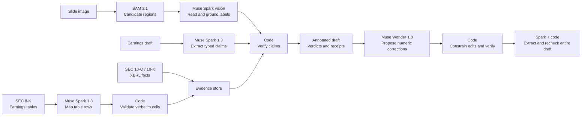

# NoCap

**NoCap checks the financial numbers in an earnings draft against the SEC filings of S&P 500 companies, and every ✓ or ✗ comes with a receipt from the filing.**

An earnings story that calls 18% quarter-over-quarter growth "year over year", or prints adjusted EPS as GAAP, reads fine until the correction runs. NoCap flags those numbers before publication and shows the filing that settles each one.

Built by **Robert Chang · Team NoCap** for the [Meta Global AI Developer Hackathon](https://cerebralvalley.ai/e/meta-ai-developer-hackathon), Indie track · Build for Your World.


Twenty seconds of the pitch demo at original speed, on the real interface: a saved NVIDIA draft returns 7 ✓, 2 ✗ and 2 ?, and the receipt for "up 18% from a year ago" computes the filed year-over-year growth, 105.85%.

**[Watch the 2:58 pitch demo](https://receipts-nocap.vercel.app/demo).** Illustrative animation tells the story; real footage of the interface, recorded locally with live model requests paused, proves each step. Narration by edge-tts, not the author's voice. [Demo kit](docs/demo/README.md).

## Try it

- **Live product:** [receipts-nocap.vercel.app](https://receipts-nocap.vercel.app), no sign-up. Paste an earnings draft about any S&P 500 company, press **Check**, and click any number for its receipt. Check, Fix with receipts, Check a slide and Ask run live through **2026-11-17 16:00 UTC**, under a shared $5 daily cap.
- **Always available at $0:** four saved examples, a real Bank of America earnings slide (**Slide → Try a real SEC slide**) and a question over Meta's complete 10-K (**Ask → Filing quotes**), replayed as recorded.
- **Also public:** the [benchmark explorer](https://receipts-nocap.vercel.app/benchmarks) and the [source code](https://github.com/changshoufeng0609-cmd/nocap). The [quickstart](#quickstart) runs offline with no key.

Rate limits, budget rules and coverage dates: [details](docs/details.md#live-site-limits-and-coverage).

## Meta models: the model proposes, code decides

No model output reaches a verdict without a deterministic check.

| Meta model | Job in NoCap | What code checks | Code |
|---|---|---|---|
| **Muse Spark 1.3** | Extracts typed claims from the draft (metric, value, period, basis, company) | Finds each quote in the draft and re-reads the number itself; a claim whose number is not in the text is dropped | [`locate_claims`](receipts/extract.py#L1402) |
| Muse Spark 1.3 | Maps 8-K earnings-release tables: 467 companies in one day (1,969 calls, $42.97) | Keeps a cell only when its own parse equals the model's value and the headers agree | [`decide_table`](receipts/press_release.py#L1244) |
| Muse Spark 1.3 (1M-token context) | Reads a complete 10-K or 10-Q in one request to find quotes | Accepts only exact, unique quotes and locates them itself | [`locate_quotes`](receipts/grounding.py#L160) |
| Muse Spark 1.3 | Ask: turns a question into a lookup plan with no answer field | The question itself must name company, metric, period and basis; code retrieves and verifies the figure | [`bind_question`](receipts/ask.py#L254) |
| **SAM 3.1** + Muse Spark vision | Finds chart and table regions on a slide; Spark reads the printed figures | Readings go through the same verifier; an axis estimate can only get ≈ or ? | [`sam_boxes`](receipts/slides.py#L172), [`reading_verdict`](receipts/slides.py#L346) |
| **Muse Wonder 1.0** | Fix with receipts: proposes corrected numbers | Only digits may change; each fix must verify, then the whole draft is checked again | [`numeric_replacement`](receipts/rewrite.py#L88) |
| Muse Wonder 1.0 | Writes trap drafts with planted errors for evaluation | Code writes every gold label from the filings; Wonder's labels are not trusted | [`validate_draft`](eval/build_traps.py#L1399) |
| **Muse Spark Open** (Fireworks, Baseten) · **Muse Glimmer** (operator's Modal) | Open-weight extraction; Glimmer powers Private check without a hosted model API | Same schema and verifier; no fallback to Meta's API | [`extract.py:340-351`](receipts/extract.py#L340-L351), [`private.py`](receipts/private.py#L76) |

All hosted calls use Standard-mode model IDs. More notes (effort sweep, Glimmer fine-tune, Agents 102 practices): [details](docs/details.md#meta-models-more-notes).

## Results

| Test | Result |
|---|---|
| **One-shot test of the deployed release:** 1,000 frozen items from 400 S&P 500 companies, run once on November 2 | **306/360 planted errors caught (85.0%); none marked ✓.** 17/1,298 true figures flagged wrong (1.3%). **A ✓ was right 736 of 738 times (99.7%).** [Methods](eval/spot500_methods.md#results-of-the-one-live-run-november-2-2026-after-round-8) |
| **Held-out seeded errors:** 97 frozen items, 48 with one planted error | **44/48 caught (91.7%)**; the 4 misses came back `?`, never ✓. 1/47 false alarms on unmodified sentences |
| **Held-out trap drafts** written by Muse Wonder | **20/20 planted errors caught**; 0/52 true figures flagged wrong |
| **Closed-book Q&A:** four Meta models answered 50 financial questions each from memory | NoCap's gate withheld all 17 assessable wrong answers |
| **Real SEC slide** (Bank of America 2Q26) | SAM 3.1 found both bar charts; all 5 GAAP bars verified, 0 wrong |
| **Whole filing in one request** (Meta's 2025 10-K) | One Muse Spark call read all 101,135 tokens in 6.1 s for $0.129; 4 exact quotes accepted |

The held-out and comprehensive tests were frozen before they ran and were run once. Method notes, intervals, the AI-written-draft benchmark and the other tests: [all results](docs/details.md#all-results).

## Architecture



FastAPI streams verdicts to a Next.js interface; the CLI and a read-only [MCP server](docs/mcp.md) use the same engine. [ADR-001](docs/adr-001-architecture.md) · [API contract](docs/api-contract.md).

## Quickstart

No API key, no model or SEC request, $0. Needs Git and Python 3.12.

```bash
git clone https://github.com/changshoufeng0609-cmd/nocap.git
cd nocap
python3.12 -m venv .venv
.venv/bin/python -m pip install -r requirements.txt
.venv/bin/python -m receipts check examples/nvda_q2_fy2027.txt
```

The output annotates the draft and lists each verdict with its filings. Abridged:

```text
✗ c8   eps_diluted · GAAP · $2.22 · NVIDIA · second quarter of fiscal 2027  [basis_mismatch]
       $2.22 is NVIDIA's non-GAAP diluted EPS for Q2 FY2027 (quarter ended Jul 26, 2026); the GAAP figure is $2.46.
...
7 ✓ verified · 2 ✗ wrong · 2 ? unverifiable · 0 ≈ approximate
```

The clone ships an approximately 98 MB snapshot of SEC evidence and cached model responses, so this rerun only exercises the verifier. To check your own drafts, put your own `MODEL_API_KEY` in a gitignored `.env` (see [`env.example`](env.example)); new drafts are sent to the Meta Model API and billed to that key. [Browser setup](docs/deploy.md#local-development) · [more examples](examples/README.md).

## What the marks mean

| Mark | Meaning |
|---|---|
| ✓ Verified | Supported by filed evidence at the precision the draft wrote |
| ✗ Wrong | Value, period, scale, accounting-basis or company mismatch; the filed value is shown |
| ◷ Not public yet | The supporting filing reached EDGAR after the chosen as-of time |
| ? Unverifiable | Ambiguous, forward-looking, unsupported or outside coverage; never guessed |
| ≈ Approximate | Consistent only as an approximation, such as a value read off a chart axis |

Each receipt names the filing form, accession number, EDGAR acceptance time and link, plus the XBRL concept, the earnings-release cell or sentence, or the arithmetic for a derived figure. [How the verifier decides](docs/details.md#how-the-verifier-decides).

## Coverage and limitations

- **Coverage:** all 500 S&P 500 companies, their latest eight fiscal quarters of 10-Q and 10-K data plus 8-K earnings releases, from a pre-ingested snapshot (not a live EDGAR feed). Anything outside it returns `?`.
- **`?` instead of guessing:** in the held-out test, 20% of true figures came back `?`; extraction can also miss a figure, so numbers no claim covers are listed as **Not checked**.
- **Fix** changes digits only. **Slides:** vision can misread a figure; confirm each reading against the image. **Ask** takes one company and one fiscal period.
- **Private check** keeps drafts off hosted model APIs, but Modal and the NoCap server still see them.
- **No user study yet**, so no measured time saving.

[Full coverage and limitations](docs/details.md#coverage-and-limitations-in-full).

## Built during the hackathon

Development started on **2026-10-27**, and all of NoCap was built during the hackathon: SEC ingestion, extraction, the verifier, the CLI, API and web app, the evaluations and the demo media. The step-by-step history stays private because it contains earlier narration audio whose licence does not allow public sharing; a public [source-history branch](https://github.com/changshoufeng0609-cmd/nocap/tree/source-history) reconstructs it as 65 commits ([scope](docs/source-history.md)). The idea grew out of the author's earlier portfolio agent and its unreliable numbers; no code from it was copied.

## Evidence

The current code passes 4,428 offline Python tests and skips 4 (an opt-in rebuild and three set-derivation checks); a fresh clone runs 4,420. There are also 244 frontend checks.

- [All results](docs/details.md#all-results) · [held-out results](eval/heldout_results.md) · [comprehensive test](eval/spot500_methods.md) · [closed-book Q&A](eval/qa_results.md)
- [Fix](docs/fix-with-receipts.md) · [Slide](docs/check-a-slide.md) · [Ask](docs/ask.md) · [Private](docs/private-mode.md) · [Open-weight backends](docs/open-weights.md) · [Spend protection](docs/spend-protection.md)
- [Evidence map and development record](docs/submission/evidence-map.md)

## Licences

Code: [MIT License](LICENSE). SEC filings, model weights, dependencies and the sample Bank of America slide keep their own terms: [data, media and licences](docs/details.md#data-media-and-licences).

**Not investment advice.** NoCap is a research and fact-checking tool with no buy or sell recommendations. Review the linked filings before relying on a result.
