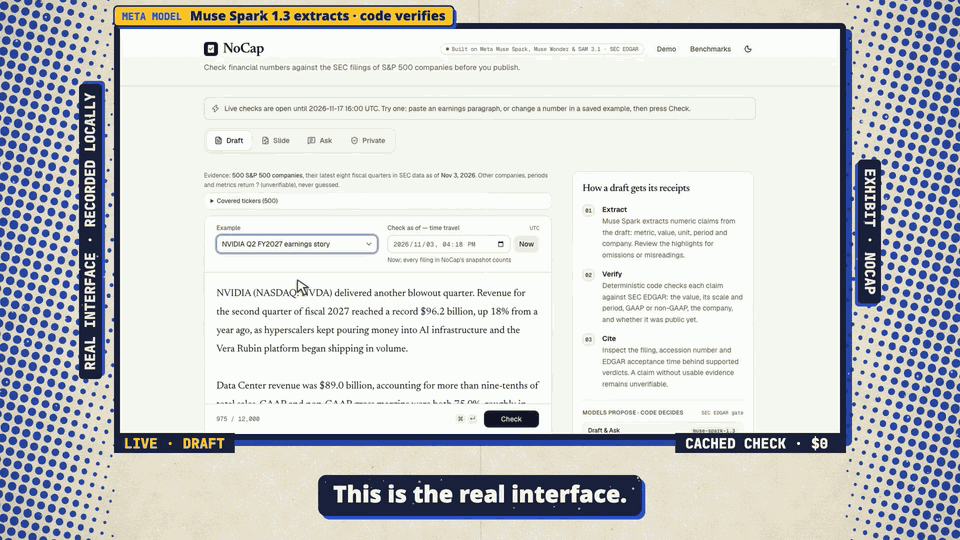
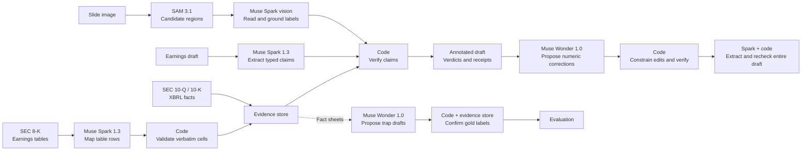

# NoCap

**NoCap checks the financial numbers in an earnings draft against the SEC filings of S&P 500 companies, and every ✓ or ✗ comes with a receipt from the filing.**

An earnings story that calls 18% quarter-over-quarter growth "year over year", or prints adjusted EPS as GAAP, reads fine until the correction runs. NoCap flags those numbers before publication and shows the filing that settles each one.

Built by **Robert Chang · Team NoCap** for the [Meta Global AI Developer Hackathon](https://cerebralvalley.ai/e/meta-ai-developer-hackathon), Indie track · Build for Your World.



Twenty seconds of the walkthrough at original speed, zoomed in on the real interface: a saved NVIDIA draft returns 7 ✓, 2 ✗ and 2 ?, and the receipt for "up 18% from a year ago" computes the filed year-over-year growth, 105.85%.

**[Watch the 2:52 walkthrough](https://receipts-nocap.vercel.app/demo).** <!-- verify-at-release --> The real interface, recorded locally and edited with zooms: Check uses cached model output; Fix, Slide, Ask and Private replay recorded live runs with the waits cut; the voice is synthetic (Kokoro-82M), not the author's, and the music is original. [Recording notes](docs/demo/README.md).

## Try it

- **Live product:** [receipts-nocap.vercel.app](https://receipts-nocap.vercel.app). Check, Fix with receipts, Check a slide and Ask run live from submission through **2026-11-17 16:00 UTC**. <!-- verify-at-release -->
- **Limits:** all live work shares a spending cap of $5 per UTC day, and each IP address is limited to 10 live requests per 10 minutes on each server instance. Slide, Ask and whole-filing questions leave the last $1.50 of each day to Check and Fix, and at most 5 new whole-filing questions run per day. When a cap is reached, that live work pauses until the next UTC day. <!-- verify-at-release -->
- **Always available:** the three saved examples, plus two recorded live runs on real SEC documents, replay at $0: **Slide → Try a real SEC slide** (a Bank of America earnings slide through SAM 3.1 and Muse Spark) and **Ask → Filing quotes** (one question over Meta's complete 10-K). <!-- verify-at-release --> Good live tests: change one number in an example and press Check, paste an earnings paragraph about any covered S&P 500 company (quarters newer than the evidence snapshot come back as `?`, never guessed), upload the [seeded demo slide](examples/slides/nvda-draft.png), or ask "What was NVIDIA's GAAP revenue in Q2 FY2027?"
- **Coverage:** all 500 S&P 500 companies (index members on October 31, 2026; Exxon Mobil's filings, split across two SEC registrants by its 2026 holding-company change, are joined into one company): the latest eight fiscal quarters of XBRL through each company's most recent 10-Q or 10-K that NoCap stored by November 1, 2026, which ended between July and early October 2026 for 297 of them, plus balance-sheet figures, and segment and non-GAAP figures from 8-K earnings-release tables for 462. Muse Spark 1.3 mapped the releases of 467 of those companies in one day on October 31 (1,969 calls, $42.97); code kept a cell only when its own parse matched, behind an XBRL gate. Anything else returns `?` by design.
- **Also public:** the [benchmark explorer](https://receipts-nocap.vercel.app/benchmarks) with all 200 closed-book answers, and the [source code](https://github.com/changshoufeng0609-cmd/nocap). <!-- verify-at-release --> The [quickstart](#quickstart) reruns the NVIDIA check offline with no key, at $0.
- **Not live on the public site:** Private check, which needs the operator's own Modal GPU deployment. **Private → Replay a recorded Private check** replays one real Modal Glimmer run on a synthetic NVIDIA draft at $0, labelled as recorded ([recorded sample](docs/private-mode.md#recorded-sample)). <!-- verify-at-release -->

## Meta models and the code that checks them

NoCap's rule is **the model proposes, code decides**. No model output reaches a verdict without a deterministic check.

| Meta model | Job in NoCap | What code controls or verifies | Code |
|---|---|---|---|
| **Muse Spark 1.3** | Extracts typed claims from the draft: metric, value, period, accounting basis, company | Code finds each quote in the draft and re-reads the number itself. A claim whose number is not in the text is dropped; offsets never come from the model. | [`extract.py:66`](receipts/extract.py#L66), [`locate_claims`](receipts/extract.py#L1402) |
| Muse Spark 1.3 | Maps 8-K earnings-release table rows and columns to metrics and periods: on October 31, the latest four releases of 467 S&P 500 companies in one day (1,969 calls, $42.97) | A cell is kept only when code's own parse of the cell text equals the model's value, and the period and scale agree with the table headers. | [`press_release.py:76`](receipts/press_release.py#L76), [`decide_table`](receipts/press_release.py#L1244) |
| Muse Spark 1.3 (vision) | Reads printed figures on an uploaded chart or table | Readings go through the same verifier. A value estimated from a chart axis can only get ≈ or ?, and a basis label that contradicts the transcription returns ?. | [`slides.py:28`](receipts/slides.py#L28), [`reading_verdict`](receipts/slides.py#L346) |
| Muse Spark 1.3 | Ask: turns a question into a lookup plan; the schema has no answer or number field | A separate grammar must find the company, metric, fiscal period and basis in the question itself. Code then retrieves the filed fact, writes the sentence and verifies it. | [`ask.py:21`](receipts/ask.py#L21), [`bind_question`](receipts/ask.py#L254) |
| Muse Spark 1.3 (1M-token context) | Whole-filing quotes: reads one complete 10-K or 10-Q in a single request and selects passages for a question | Code checks the filing's hash, SEC URL and acceptance time before the call, refuses rather than truncates an oversized filing, and accepts only exact, unique quotes, locating their offsets itself. | [`grounding.py:128`](receipts/grounding.py#L128), [`locate_quotes`](receipts/grounding.py#L160) |
| **SAM 3.1** | Proposes bar-chart and table regions on an uploaded slide | Regions only frame the image for Spark and never count as evidence. When SAM finds no usable region, Spark grounding supplies one and the UI labels its source. | [`slides.py:26`](receipts/slides.py#L26), [`sam_boxes`](receipts/slides.py#L172) |
| **Muse Wonder 1.0** | Fix with receipts: proposes corrected numbers for the wrong claims | Only the digits may change. Each fix must verify, then the whole revised draft is extracted and checked again, and every other claim must keep its meaning. | [`rewrite.py:26`](receipts/rewrite.py#L26), [`numeric_replacement`](receipts/rewrite.py#L88), [`_consistent`](receipts/rewrite.py#L268) |
| Muse Wonder 1.0 | Writes realistic earnings stories with planted errors (trap drafts) for evaluation | Code re-reads every figure against the evidence store and writes every gold label itself; Wonder's own labels are not trusted. | [`build_traps.py:79`](eval/build_traps.py#L79), [`validate_draft`](eval/build_traps.py#L1399) |
| **Muse Spark Open** on Fireworks and Baseten | Optional open-weight extraction backend | Same claim schema, span checks and verifier. A missing backend never falls back to Meta. | [`extract.py:340-348`](receipts/extract.py#L340-L348) |
| **Muse Glimmer** on the operator's Modal | Private check: extracts claims without sending the draft to a hosted model API | Only an HTTPS Modal endpoint is accepted, with no redirects, no response caching and no fallback; the same verifier decides. | [`extract.py:351`](receipts/extract.py#L351), [`private.py:44`](receipts/private.py#L44), [`make_private_client`](receipts/private.py#L76) |

All hosted calls use Standard-mode model IDs, and code rejects any `-contributor` ID ([`extract.py:294`](receipts/extract.py#L294)). The checks earn their place: tried as an extractor, Muse Wonder returned 9 of 23 claims with the wrong unit, and because code re-reads every number from the quoted text, none of its unmatched claims came back ✓ ([benchmark](eval/bench_results.md)). Independently of our tests, Fireworks' [Specialized Intelligence Index](https://fireworks.ai/specialized-intelligence-index/) ranks Muse Spark Open the best open model on Rogo's Big Finance financial-research benchmark: 53.3% final-answer accuracy, third of 14 models (index updated October 30, 2026; checked November 1, 2026). A LoRA fine-tune of Muse Glimmer 30B on Fireworks (training free under a Fireworks promotion), trained on Muse Spark 1.3's code-accepted extractions, matched the teacher's exact claim sets more often (51 vs 39 of 70 development passages kept out of training; suggestive only, since p = 0.023 does not survive correction for five tests and most of the gain is period wording) and answered with 72% fewer tokens, with no meaningful change in NoCap's verdicts (68 vs 66 of 70); the product still runs base Glimmer ([experiment](eval/glimmer_sft/results.md)). Extraction runs at Muse Spark 1.3's minimal reasoning effort because more effort bought nothing on our gold set: in one live run per level, minimal, low and medium all found 27 of 27 claims with identical labels and verifier verdicts, while low and medium cost 1.9× and 3.0× as much and took 16 s and about 21 s instead of 7 s ([effort sweep](eval/effort_sweep.md); one run per level on one press release, not a general accuracy claim).

### Verifiable-agent practices

The hackathon's *Agents 102: Best Practices for Verifiable Agents* workshop recommends mandatory verification, deterministic checks before any model judgement, a ground-truth reference, feedback from the verifier and a human at the end. NoCap is a bounded verification pipeline, not an autonomous agent, and applies each practice in code:

| Practice | In NoCap |
|---|---|
| Verification is part of the submit step, not a tool the model may skip | Every verdict, Fix edit and numeric Ask answer passes the deterministic verifier before the user sees it; an edit that doesn't verify never enters the draft ([`rewrite.py:381`](receipts/rewrite.py#L381)). Filing quotes must match the filing exactly. |
| Deterministic checks first: did the model invent a number? | A claim whose number isn't in the quoted text is dropped ([`locate_claims`](receipts/extract.py#L1402)); numbers no claim covers are listed as **Not checked** ([`numeric_coverage`](receipts/coverage.py#L113)). |
| Check against ground truth, as strictly as the domain needs | SEC filings are the ground truth, read at the precision the draft wrote. Finance can't afford false flags, so ambiguity returns ?, never ✗; measured false alarms are 1 of 47 unmodified held-out sentences and 0 of 52 true trap-draft figures ([Results](#results)). |
| Allow-list what the model may do | Wonder may return only a claim ID and replacement digits for claims the verifier sent it; anything else is discarded ([`rewrite.py:343-371`](receipts/rewrite.py#L343-L371)). Ask's plan schema has no answer or number field. |
| Feed the verifier's output back and end with a human | Wonder receives the verifier's expected value, explanation and receipts ([`rewrite.py:232`](receipts/rewrite.py#L232)). What remains is listed for the editor, who reviews each receipt and copies the revision; NoCap never publishes. |

**Where NoCap differs:** there is no LLM-as-a-judge, because filings make correctness machine-checkable; Fix makes one attempt instead of a retry loop ([`rewrite.py:320`](receipts/rewrite.py#L320)); and the [MCP server](docs/mcp.md) offers the verifier to other agents as a tool, so making it mandatory there is the host agent's job.

## Results

| Test | Result |
|---|---|
| **Held-out seeded errors:** 97 frozen test items built from real earnings-release sentences; 48 carry one planted error (value, period, scale, basis, company or look-ahead) | **44/48 caught (91.7%)**. The 4 misses came back `?`, never ✓. |
| False alarms on the 47 unmodified sentences | **1/47 (2.1%)** |
| True figures left `?` instead of guessed | 22/110 (20.0%) |
| **Held-out trap drafts:** 7 earnings stories written by Muse Wonder, 20 planted errors | **20/20 caught.** 0/52 true figures flagged wrong; 3/52 left `?`. |
| **Closed-book Q&A:** Spark 1.3, Wonder 1.0, Spark Open (Baseten) and Glimmer (Modal) each answered the same 50 questions from memory, without filings or tools; NoCap's gate checked every answer | **The gate blocked every assessable wrong answer, but accepted only 0–34% of each model's answers:** it withheld all 17 and accepted 37 correct answers. |
| **Qualifier robustness:** 8 real figures × 16 qualifying phrases × 4 positions × 2 placements (in the model's metric description or only in the quoted sentence), with the model's basis empty or GAAP (2,048 variants; deterministic) | **No qualified figure verified against GAAP evidence**; 48 verified against the company's own reported non-GAAP figure, the rest `?`. 16/16 unqualified controls verified. [Details](eval/qualifier_robustness.md) |
| **Open-weight extraction:** the same pipeline on Muse Spark Open, 10-passage NVIDIA gold set | 27/27 gold claims found on Fireworks and on Baseten; the one extra claim stayed `?`. |
| **Real SEC slide:** page 9 of Bank of America's 2Q26 earnings presentation, as filed in its 8-K | SAM 3.1 found both bar charts. **All 5 GAAP net-interest-income bars verified** against BAC's 10-Qs and 10-K; the non-GAAP (FTE) totals and untracked yields stayed `?` (27; the 32-reading limit was reached); 0 wrong. 3 model calls, 21 s, $0.030. |
| **Whole filing in one request:** Meta's 2025 10-K, 516,028 characters, asked about 2026 capital spending and Reality Labs losses | **One Muse Spark call read the entire filing: 101,135 input tokens**, 6.1 s, $0.129. Code accepted 4 exact quotes and rejected none. |

Held-out results describe frozen source `61e1055`, run once on October 29 (117 Spark calls, $0.498 of usage), and were not rerun after later verifier fixes. The sets are small and correlated; labels are provisional and machine-assisted, with no independent human review yet. The Q&A figures come from a post-run analysis that only normalizes unit and period labels; the pre-registered strict parser accepted none of the 200 answers. Speed and cost: a live check of the 11-claim NVIDIA example made 5 Spark calls in 3.9 seconds for $0.013 (measured locally on October 27).
The two real-document runs (October 30) are single demonstrations, not accuracy measurements: one slide and one filing, the latter using about 10% of the 1M-token window. Both are recorded and replay at $0 on the public site ([slide run](docs/check-a-slide.md#real-sec-slide-sample-2026-10-30), [filing run](docs/ask.md#whole-filing-live-validation-2026-10-30)). <!-- verify-at-release -->

## Architecture



FastAPI streams verdicts to a Next.js interface; the CLI and a read-only [MCP server](docs/mcp.md) use the same engine. Details: [ADR-001](docs/adr-001-architecture.md), [API contract](docs/api-contract.md).

## Quickstart

No API key, no model or SEC request, $0. Needs Git and Python 3.12.

```bash
git clone https://github.com/changshoufeng0609-cmd/nocap.git
cd nocap
python3.12 -m venv .venv
.venv/bin/python -m pip install -r requirements.txt
.venv/bin/python -m receipts check examples/nvda_q2_fy2027.txt
```

The output annotates the draft and lists each verdict with its filings. Abridged:

```text
✗ c8   eps_diluted · GAAP · $2.22 · NVIDIA · second quarter of fiscal 2027  [basis_mismatch]
       $2.22 is NVIDIA's non-GAAP diluted EPS for Q2 FY2027 (quarter ended Jul 26, 2026); the GAAP figure is $2.46.
...
7 ✓ verified · 2 ✗ wrong · 2 ? unverifiable · 0 ≈ approximate
number coverage: 10/10 digit-based candidates linked to extracted claims (not a correctness verdict)
extraction: 5 passage call(s), 5 cached, $0.0000, 0.0 s
```

The clone ships an approximately 98 MB snapshot of SEC evidence and cached model responses ([`data/snapshot/`](data/snapshot/)), so this rerun only exercises the verifier. To check your own draft, put `MODEL_API_KEY` in a gitignored `.env` (see [`env.example`](env.example)); new drafts are sent to the Meta Model API and billed. [Browser setup](docs/deploy.md#local-development) · [more examples](examples/README.md).

## How the verifier decides

Code resolves each claim's company and fiscal period, then compares the value with SEC evidence at the precision the draft wrote ("$96.2 billion" allows ±$0.05 billion). It also checks scale, year-over-year versus quarter-over-quarter, month-named quarters, GAAP versus non-GAAP, which company named in the draft a figure belongs to, bounds such as "more than", split-adjusted per-share values and, given an as-of time, whether the filing had reached EDGAR. Beyond income-statement figures and growth rates, it checks net and operating margins and margin changes in basis or percentage points from one filing's own figures, balance-sheet figures (cash, total assets and liabilities, equity, debt, shares outstanding) at their balance-sheet date, and 16- or 17-week quarters by their own dates. Where a filing reports more than one net income (including noncontrolling interests, attributable to the company, or available to common stockholders), a draft that names one is checked against that line, and an unnamed figure that matches another line gets `?` with both figures, not ✗. A margin change matches the filed figures or the margins as the company prints them, and one non-GAAP measure (adjusted revenue) is never refuted with another (taxable-equivalent revenue).

| Mark | Meaning |
|---|---|
| ✓ Verified | Supported by filed evidence at the stated precision |
| ✗ Wrong | Value, period, scale, accounting-basis or company mismatch; the filed value is shown |
| ◷ Not public yet | The supporting filing was accepted after the as-of time; kept apart from errors |
| ? Unverifiable | Ambiguous, forward-looking, unsupported or outside coverage |
| ≈ Approximate | Consistent only as an approximation, such as a value read off a chart axis |

Each receipt names the filing form, accession number, EDGAR acceptance time and link, plus the XBRL concept, the verbatim earnings-release cell, or the arithmetic for a derived figure. Numbers that no claim covers are listed as **Not checked**, so extraction gaps stay visible; the list is a hint, not proof of completeness.

## Coverage and limitations

- **Coverage:** all 500 S&P 500 companies, latest eight fiscal quarters, **243,839 stored facts** from 28,607 filings (146,954 XBRL and derived plus 96,885 8-K earnings-release figures; 38 companies are XBRL-only), plus 39,701 balance-sheet figures and 7,572 alternative net-income figures (consolidated or to common stockholders) held only to check a draft that names them and to flag ambiguity. Gates drop what doesn't hold up instead of guessing around it: a release GAAP figure that the paired 10-Q or 10-K contradicts (unless a documented restatement explains it), a quarter tagged with a full-year value, a derived fourth quarter on mixed bases, release net income that includes noncontrolling interests, and fiscal labels a company's own filings disagree on. Revenue returns `?` where a company tags only a component that no release total confirms (NextEra Energy, Iron Mountain) or prints only a non-GAAP total (Fifth Third's taxable-equivalent revenue). The snapshot is pre-ingested, not a live EDGAR feed: on October 31 it grew from 11 to 499 companies, and on November 1 Exxon Mobil joined and 50 10-Qs and 10-Ks missing from SEC's companyfacts were read from their own XBRL instances ([evidence expansions](docs/evidence-expansion.md)).
- **`?` instead of guessing:** unsupported metrics, unclear bases, guidance and unresolved periods return `?`; in the seeded held-out test, 20% of true figures did. Extraction can also miss a figure.
- **No user data yet:** no real user sessions so far, so no measured time saving.
- **Time travel** uses EDGAR acceptance time, not the moment a number first reached a newswire.
- **Fix** changes digits only; look-ahead errors and anything needing new wording stay for manual review.
- **Slides and whole filings:** vision can misread or omit a figure, so confirm each highlighted reading against the image, which is never evidence. SAM found both charts on the real Bank of America slide but no usable region on the seeded demo slide, where Spark grounding supplied one. A dense slide can hit the 32-reading limit. Whole-filing quotation sends one complete 10-Q or 10-K to Spark's 1M-token context and accepts only exact, unique quotes; a quote shows where text appears, not that it is relevant or true. Recorded samples are replayed as recorded, not re-verified on later code.
- **Ask** takes one company and one explicit fiscal period; no comparisons, forecasts or advice.
- **Private check** is hosted, not offline: Modal and the NoCap server still see the draft. One end-to-end browser test on a two-claim draft returned 1 ✓ and 1 ✗.
- **Input limits:** drafts up to 12,000 characters, split into extraction passages of at most 6,000 characters; slides as one PNG or JPEG up to 2 MiB. Live checks reserve the estimated cost of every passage and allowed retry before starting, subject to the daily budget.

## Built during the hackathon

Development started on **2026-10-27**, and all of NoCap was built during the hackathon: SEC ingestion, extraction, the verifier, the CLI, API and web app, the evaluations and the demo media. The public `main` branch is a clean export first published on October 29. The step-by-step history stays in the private development repository because it contains earlier narration audio whose licence does not allow public sharing. A public [source-history branch](https://github.com/changshoufeng0609-cmd/nocap/tree/source-history) reconstructs it as 65 commits of source and configuration files ([scope and mapping](docs/source-history.md)). <!-- verify-at-release -->

**Prior work:** the idea grew out of the author's earlier Taiwan portfolio agent and its unreliable financial numbers. Only the concept carries over; no code from that project was copied. Libraries, model weights and SEC filings keep their own provenance and licences.

## Evidence

The current code passes 2,986 offline Python tests (a fresh clone installed from `requirements-mcp.txt` runs 2,982, and 4 need gitignored local data; with only `requirements.txt`, the optional MCP server's tests are skipped) and 232 frontend checks. <!-- verify-at-release -->

- [Held-out results and audit](eval/heldout_results.md) · [closed-book Q&A](eval/qa_results.md) and its [methods](eval/qa_methods.md), reproducible offline
- [Open-weight backends](docs/open-weights.md) · [extraction benchmark](eval/bench_results.md)
- [Fix](docs/fix-with-receipts.md) · [Slide](docs/check-a-slide.md) · [Ask and whole-filing quotes](docs/ask.md) · [Private](docs/private-mode.md) · [Spend protection](docs/spend-protection.md)
- [Evidence map and development record](docs/submission/evidence-map.md): test history, development-set results, review findings, commit hashes and release records. The reviews it lists are AI-assisted simulations, not human judging or human label review.

## Data, media and licences

- **Data:** [SEC EDGAR](https://www.sec.gov/search-filings/edgar-application-programming-interfaces) submissions and XBRL APIs, 10-Q and 10-K filings, and 8-K earnings-release exhibits. Accession numbers and URLs travel with every fact. [`receipts/edgar.py`](receipts/edgar.py) declares a User-Agent, caches locally and makes at most two requests per second. Filing reuse: [SEC guidance](https://www.sec.gov/about/webmaster-frequently-asked-questions).
- **Models:** Muse Spark 1.3, Muse Wonder 1.0 and SAM 3.1 through the Meta Model API; Muse Spark Open through Fireworks and Baseten; Muse Glimmer on Modal. Terms and licences: [backend guide](docs/open-weights.md).
- **Narration:** synthetic voice from Kokoro-82M (Apache-2.0) via kokoro-onnx (MIT): [sources and permissions](docs/demo/narration-license.md).
- **Sample slide:** [`web/public/samples/bac-2q26-net-interest-income.jpg`](web/public/samples/bac-2q26-net-interest-income.jpg) is page 9 of Bank of America Corporation's 2Q26 earnings presentation, filed with the SEC as Exhibit 99.2 to its Form 8-K (accession 0000070858-26-000353, accepted July 14, 2026; [source image](https://www.sec.gov/Archives/edgar/data/70858/000007085826000353/bac06302026ex992009.jpg)). It is used unmodified (SHA-256 `ab5ceb8d…`) for illustration only: it shows NoCap checking a real filed slide, in the app and in the demo videos. Its footnote refers readers to slide 32 of the full presentation for important presentation information. Bank of America Corporation retains all rights in the slide and its logo; the MIT License does not cover it, and NoCap is not affiliated with or endorsed by Bank of America.
- **Code:** [MIT License](LICENSE); it does not relicense filings, model weights or dependencies.

**Not investment advice.** NoCap is a research and fact-checking tool with no buy or sell recommendations. Review the linked filings before relying on a result.
