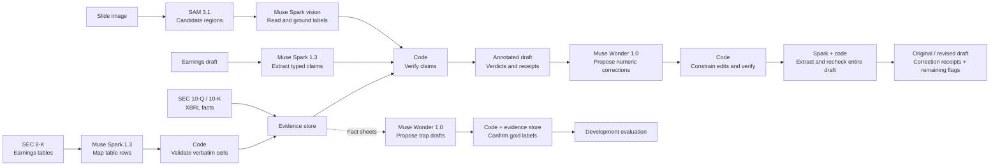

# NoCap

**Check the financial numbers in an earnings draft against SEC filings before publishing.**

Built by **Robert Chang · Team NoCap** for the [Meta Global AI Developer Hackathon](https://cerebralvalley.ai/e/meta-ai-developer-hackathon), Indie track · Build for Your World.


[Watch the 165-second walkthrough](https://receipts-nocap.vercel.app/demo) · [English captions and recording notes](docs/demo/README.md). A continuous recording of the actual local browser workflow, with cached Check extraction, disclosed recorded Fix/Slide/Ask responses and local synthetic narration. It is a demonstration, not a live latency measurement. The published export passed anonymous desktop/mobile playback and download checks.

**Try NoCap:** open the [public workspace](https://receipts-nocap.vercel.app) and choose a built-in example, [watch the demo](https://receipts-nocap.vercel.app/demo), or [explore all 200 Q&A records](https://receipts-nocap.vercel.app/benchmarks). The updated release passed anonymous desktop/mobile checks for saved results, receipts, 165-second playback with 18 caption cues, matching media downloads and the benchmark record download. **Live model requests are paused**; new draft checks, corrections, Slide and Ask requests are not currently open. [Source code](https://github.com/changshoufeng0609-cmd/nocap) and the [licensed video download](https://raw.githubusercontent.com/changshoufeng0609-cmd/nocap/main/docs/demo/assets/receipts-demo.mp4) are public. [Current release evidence](docs/public-release-update-2026-10-29.json) preserves the [earlier 179.937663-second release](docs/public-release-2026-10-29.json) as history.

## The problem

Financial journalists and analysts publish numbers under deadline pressure. A plausible earnings story can mix GAAP and adjusted EPS, compare the wrong quarters, or turn billions into millions. Finding the error means reopening filings and tracing each number to its source.

NoCap turns that review into an annotated draft. Click a number to see the filed value, the reason for the verdict, and the filing that supports it. An optional **as-of** cutoff checks whether the evidence had reached EDGAR at the time you specify.

## How it works

**The LLM proposes; code decides.** Muse Spark extracts typed claims. Deterministic code resolves companies and fiscal periods, applies the draft's written precision and bounds, and checks values against stored evidence.



The verifier checks value, unit and scale, fiscal period, GAAP versus non-GAAP, company attribution, and filing availability. It also handles month-named quarters, bound phrases such as “more than,” and split-adjusted per-share versions.

| Mark | Meaning |
|---|---|
| ✓ Verified | Supported by the available filing evidence at the stated precision. |
| ✗ Wrong | A value, period, scale, accounting-basis or company mismatch. |
| ◷ Not public yet | Evidence was filed after the as-of cutoff; displayed separately from numerical errors. |
| ? Unverifiable | Ambiguous, forward-looking, unsupported, or outside coverage. |
| ≈ Approximate | Supported as an approximation rather than an exact match. |

Filing receipts include the filing form, accession number, EDGAR acceptance time, source link, and an XBRL concept, verbatim press-release cell, or derivation note. An unverifiable claim may have no receipt. The UI highlights numbers in the **draft** and links out to the original filing.

**Number coverage:** a separate deterministic scan compares digit-based
number candidates with the exact values in extracted claims. Omitted candidates appear as **Not checked**,
with their location in the draft, separate from verdicts. Dates and recognized identifiers are excluded.
This catches visible extraction gaps without another model call; it is a heuristic, not proof that every
financial statement was found or verified. Check and Fix report text coverage; slide coverage is not measured.

**[Fix with receipts](docs/fix-with-receipts.md):** after a check finds wrong numbers, ask Wonder to propose corrections. Code allows only numeric substitutions, checks each change against the filings, then extracts and verifies the whole revised draft under the same context and cutoff. Compare both drafts side by side, inspect the receipts, and copy the revised text with or without citations. Your original stays intact. Guidance and unresolved flags remain visible; a correction is withheld if rechecking loses a figure or changes its meaning.

**[Check a slide](docs/check-a-slide.md):** upload a single PNG/JPEG, inspect SAM or Spark chart regions, and click a numeric reading for its SEC receipt. Printed labels use the verifier; axis estimates can only be ≈ or ?. Vision can misread or omit figures, so confirm each reading against the image. Try the [original seeded demo slide](examples/slides/nvda-draft.png).

**[Ask with receipts](docs/ask.md):** ask an explicit question such as “What was NVIDIA's GAAP revenue in Q2 FY2027?” Spark proposes lookup parameters; code independently matches them to the question, retrieves eligible facts, writes the answer and verifies each sentence. Unsupported comparisons, advice and ambiguous requests require clarification. The same workspace includes whole-filing quote search: a selected, pre-ingested SEC document is sent in full, and accepted quotes must match a unique exact span. A quote is source attribution, not a verified financial verdict. The interface and guards are implemented; real whole-filing acquisition/live validation still requires a valid SEC contact identity.

**[Private check](docs/private-mode.md):** an explicit draft-only workflow routes extraction to the operator's Muse Glimmer deployment on Modal, without NoCap response caching or fallback to a public model provider. It fails closed when setup is unavailable. This is hosted processing, not offline computation; Modal and the NoCap host still handle the draft. A real local browser → FastAPI HTTP → Modal → deterministic-verifier check completed with **1 verified / 1 wrong** from one model call. Clear/mode-switch behavior and absence of application caching or browser credentials passed checks. All task apps were then confirmed stopped with zero running tasks. This is a two-claim local integration check, not public Private availability or a quality benchmark. [Validation and billing scope](docs/private-http-live-validation-2026-10-29.json).

**[Local MCP server](docs/mcp.md):** connect an agent to three read-only stdio tools for coverage discovery, bounded evidence search and deterministic typed-claim verification with historical cutoffs. The tools themselves make no model or SEC calls. Agent hosts retain their own privacy responsibilities.

**Available in the codebase:** CLI, streaming FastAPI API and Next.js Check/Fix/Slide/Ask/Private workflows, plus the optional MCP server. Spark is the default extractor; Wonder proposes corrections and generated trap drafts. Muse Spark Open on **Fireworks and Baseten has passed live benchmarks** through the same verifier. SAM and Spark vision power slide readings, with duplicate reconciliation and abstention on conflicting readings. Deployment and live-validation status are recorded separately in the [remaining-work checklist](docs/remaining-work.md). See the [architecture](docs/adr-001-architecture.md), [API contract](docs/api-contract.md), and [backend setup guide](docs/open-weights.md).

## Quickstart: a cached example in five commands

Requires **Git and Python 3.12** and network access to clone and install dependencies. The public repository and its initial release history were verified through anonymous HTTP on October 29.

```bash
git clone https://github.com/changshoufeng0609-cmd/nocap.git
cd nocap
python3.12 -m venv .venv
.venv/bin/python -m pip install -r requirements.txt
.venv/bin/python -m receipts check examples/nvda_q2_fy2027.txt
```

Expected summary:

```text
7 ✓ verified · 2 ✗ wrong · 2 ? unverifiable · 0 ≈ approximate
```

The fresh clone automatically uses [`data/snapshot/`](data/snapshot/): roughly 5.5 MB of bundled evidence and cached Spark responses. This check makes **no model or SEC requests**, needs no API key, and adds **$0 model spend**. It reruns the verifier against cached extraction; it is not a new live extraction measurement.

To check your own draft, put `MODEL_API_KEY` in a local, gitignored `.env` using [`env.example`](env.example) as a reference, then run the same command with your text file. New drafts are sent to the selected model provider and incur its charges. `SEC_USER_AGENT` is needed when rebuilding evidence, not when checking against the snapshot. Do not overwrite an existing `.env` or commit keys.

For the browser interface, follow [local API and web setup](docs/deploy.md#local-development). More drafts, exact contexts, historical cutoffs and expected verdicts are in [`examples/README.md`](examples/README.md).

Fix with receipts requires a Meta `MODEL_API_KEY` for Wonder, including when extraction uses another backend. It makes paid model calls and shares the API's rate limit and durable estimated spend admission. Unknown usage retains conservative charges; the UI labels estimates and shows unavailable accounting explicitly. Vercel requires a shared ledger by default, while local development uses SQLite. See [spend protection](docs/spend-protection.md). Existing extraction caches can be reused; correction proposals are not cached. Mock mode demonstrates the check UI but does not generate corrections.

## Results: held-out, development and closed-book Q&A

The integrated October 29 core fixes passed **1,246 full-suite Python tests** and retained the **144 frontend checks**. [J2](docs/j2-review-2026-10-29.md) independently closed both semantic guard findings with 98 targeted tests and eight unchanged before/after probes. Development baselines and all three saved-example counts were preserved. Earlier 905/119 and 1,117-plus-two-targeted checkpoints remain historical. The owner-authorized **held-out evaluation is complete**, with no result-driven tuning. Current release steps are in the [round record](docs/completion-round-2026-10-29.md).

| Held-out measure | Seeded-error test: v0 + basis5 | Wonder trap test |
|---|---:|---:|
| Inputs | 97 items | 7 drafts |
| Errors caught | **44/48 (91.7%)** | **20/20 (100%)** |
| Correct error reason | 42/48 (87.5%) | 18/20 (90.0%) |
| False alarms | **1/47 original items; 1/110 true claims** | **0/52 true figures; 0/25 true sentences** |
| Unverifiable true claims/figures | 22/110 (20.0%) | 3/52 (5.8%) |

All four uncaught seeded test errors remained `?`, not ✓; all ten trap-test guidance figures remained `?`. The held-out run made **117 model attempts**, cost **$0.49834625** by recorded usage, and retained zero errors/skips or estimated-usage attempts. All 126 frozen files remained unchanged. These are small held-out splits of correlated, provisionally labeled corpora, not independent human adjudication or general financial accuracy. The **one original-item false alarm** must not be replaced by the development set's zero. [Held-out methods, results and records](eval/heldout_results.md).

The following development sets were used during implementation and are reported separately:

| Measure | Seeded-error dev: v0 + basis5 | Wonder trap dev |
|---|---:|---:|
| Inputs | 224 items | 15 drafts |
| Errors caught | **104/109 (95.4%)** | **40/40 (100%)** |
| Correct error reason | 97/109 (89.0%) | 36/40 (90.0%) |
| False alarms | **0/107 original items** | **0/112 true figures; 0/58 true sentences** |
| Unverifiable true claims/figures | 51/250 (20.4%) | 1/112 (0.9%) |

The false-alarm denominators differ: v0 counts original items with any false flag; trap dev counts individual figures and sentences. Trap guidance is separate: all 13 guidance figures remained `?`. There were zero conflicting ✓/✗ verdicts on the 40 planted trap errors. The five uncaught v0 errors all returned `?`, not ✓.

These are small development sets used during implementation. Corpus sentences and table evidence come from the same releases, so they are correlated. They do not establish accuracy on arbitrary financial writing. See [evaluation methods and limitations](eval/README.md), the [Wonder gold-label audit](eval/trap_dev_validation.json), and the [model extraction benchmark](eval/bench_results.md). The latest rechecks reused model-response caches and added $0 model spend; their timings are not live model latency.

**Open-weight live benchmarks:** Fireworks (2026-10-28) and Baseten (2026-10-29) each matched **27/27 provisional gold claims**, with **27/28 (96.4%) strict precision**. The extra claim is a GAAP/non-GAAP expansion of one quoted guidance tolerance, retained as `?`; the gold labels await independent human review. Each completed the same separate **13-item dev subset**: **6/6 planted errors caught**, **0/6 false alarms** and no planted error marked ✓. The ten-passage gold checks took **71.74 s / about $0.054** on Fireworks and **5.05 s / about $0.043** on Baseten. The 23 benchmark calls cost **$0.13005095** on Fireworks and **$0.10923670** on Baseten at published token rates, excluding separate smoke checks. These are different-date, single-run observations with different provider prompt-cache usage, not a controlled speed or cost ranking. Meta rows reuse earlier cached measurements. See the [comparison table](eval/bench_results.md), [Fireworks record](eval/bench_runs/fireworks-20261028.json), [Baseten record](eval/bench_runs/baseten-20261029.json) and [limitations](docs/open-weights.md#baseten-live-validation).

**Expanded comparison:** a separate fixed-seed **50-item dev sample** gives both cached Meta Spark and fresh Baseten Spark Open **24/24 errors caught, 23/24 expected reasons, 0/24 original false alarms**, and **2/2 guidance controls left unverifiable**. Baseten made 48 new calls, with two identical extraction requests reused inside the run; independent usage accounting is **$0.24020610**. Meta made zero new calls. All 100 outcomes reproduced in a zero-spend replay. The sample is correlated development data with provisional labels, not a held-out score. [Selection, complete records and limitations](eval/expanded_dev_results.md).

**Closed-book Q&A:** four backends completed the same **50 fixed questions each (200 calls)** without retrieval or tools. The original strict metadata contract accepted no answers; its rejection counts mix format/binding and numeric failures. An explicitly **post-run metadata sensitivity analysis** accepted 14/50 Spark, 0/50 Wonder, 17/50 Baseten Spark Open and 6/50 Glimmer answers, with no incorrect answer accepted in this small supported set. Precision is **N/A** for Wonder because none were accepted. Coverage was only **28% / 0% / 34% / 12%**; the result does not show that any model becomes trustworthy. Reference labels share the SEC evidence store and await human adjudication. The frozen gate predates the J2 runtime fixes and is retained unchanged; these are not measurements of the later production code. [Complete results](eval/qa_results.md), [methods and offline reproduction](eval/qa_methods.md), and the [public benchmark explorer](https://receipts-nocap.vercel.app/benchmarks) retain every response and failure. Anonymous desktop/mobile checks confirmed that both downloaded record sets match all 200 committed responses.

## Built during the hackathon

Development began on **2026-10-27**. The NoCap implementation was written during the hackathon. The October 29 release is exported as a clean snapshot; the original incremental development history is retained in the private development repository. A [public filtered source-history branch](https://github.com/changshoufeng0609-cmd/nocap/tree/source-history) now contains 65 reconstructed commits and 104 final source/configuration files, through the post-J2 checkpoint. Its [scope and mapping](docs/source-history.md) distinguish reconstructed history from original Git objects and independent timestamp attestation. Public release commits record exported versions, not the date every feature was first written. Third-party libraries and model weights retain their own provenance and licenses.

**Prior-work disclosure:** the idea grew out of the author's earlier Taiwan portfolio agent and its unreliable financial numbers. Only the concept carries over. No code from that earlier project was copied into NoCap.

## Limitations

- **Coverage:** 11 companies with the latest eight fiscal quarters targeted: NVDA, AAPL, MSFT, META, AMZN, GOOGL, JPM, BAC, AMD, NFLX and TSLA; **11,554 stored facts**. [Tesla coverage](docs/evidence-expansion.md) is XBRL-only, with EPS in 6/8 quarters and no image-based earnings tables, segments or non-GAAP figures. Coverage is incomplete by metric; stored records are not independent test examples. The snapshot is pre-ingested evidence, not a live EDGAR feed.
- **Extraction and ambiguity:** a model can miss or mislabel a claim. Unsupported metrics, unclear accounting bases, guidance and unresolved periods can return `?`; a high catch rate does not mean every number was verified. The API accepts drafts up to 6,000 characters.
- **Time travel:** the cutoff uses EDGAR acceptance timestamps. It does not establish when a number first became public through another channel.
- **Corrections:** Fix with receipts changes numeric fragments, not prose, signs, units, companies or accounting labels. Look-ahead errors, overlapping claims and unsafe or unverified proposals stay for manual review. A revised draft can still contain `?` claims, and model extraction remains fallible.
- **Slides:** single PNG/JPEG, 2 MiB and 8 megapixels maximum; PDFs and multi-slide batches are unsupported. Visual transcription and grounding remain fallible. The image itself never becomes filing evidence.
- **New workflows:** Ask supports one company and one explicit fiscal period, not investment advice or open-ended analysis. Exact whole-filing quotes prove where text appears, not its relevance or truth; live whole-document validation is still pending. Private mode needs an authenticated operator Modal deployment and does not make Ask/Fix/Slide private.
- **Hosted status:** the public workspace, source, 165-second licensed demo and benchmark explorer are available. [Current anonymous acceptance](docs/public-release-update-2026-10-29.json) passed six saved-example replays, two paused-request responses, media playback/download checks and both benchmark downloads, adding zero model calls and zero provider cost. Live requests remain paused pending the operating window; public Private and whole-filing availability remain explicitly disabled. Historical paid checks and shared-ledger tests remain separate in [deployment status](docs/deploy.md#current-deployment-state). The shared Neon allowance is admission accounting, not a provider billing ceiling. Final submission and consent remain open; see the [remaining-work checklist](docs/remaining-work.md).

## Not investment advice

NoCap is a research and fact-checking tool. It does not provide investment advice or buy/sell recommendations. Review the linked filings before relying on a result.

## Data sources and licenses

Financial evidence comes from [SEC EDGAR submissions and XBRL APIs](https://www.sec.gov/search-filings/edgar-application-programming-interfaces), 10-Q/10-K filings, and earnings-release exhibits attached to 8-Ks. Source accessions and URLs travel with the evidence. Ingestion uses [`receipts/edgar.py`](receipts/edgar.py), a declared User-Agent, local caching and a limit of two requests per second per process, shared across clients.

NoCap code is available under the [MIT License](LICENSE). This license does not relicense source filings, model weights or third-party dependencies. See the [SEC's reuse guidance](https://www.sec.gov/about/webmaster-frequently-asked-questions) for filing content; model access and licenses are linked in the [backend guide](docs/open-weights.md).
